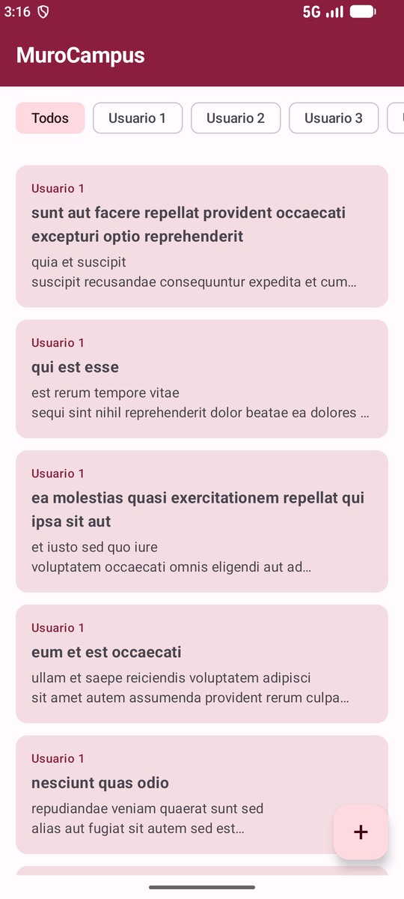
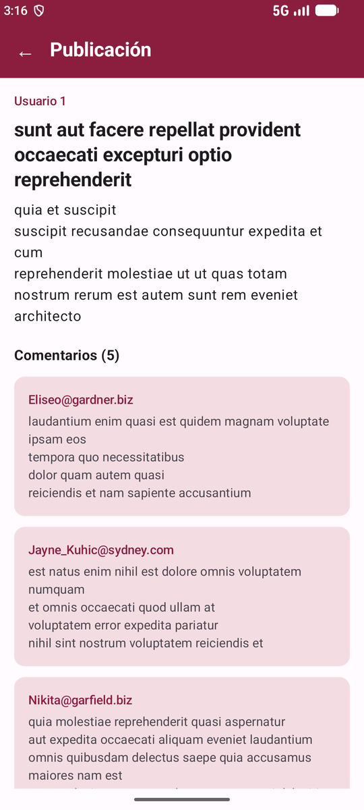
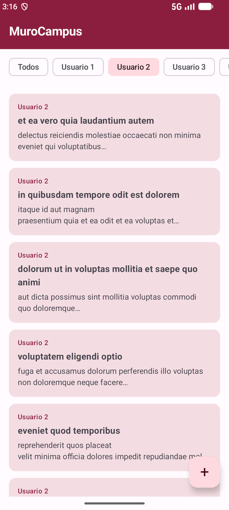
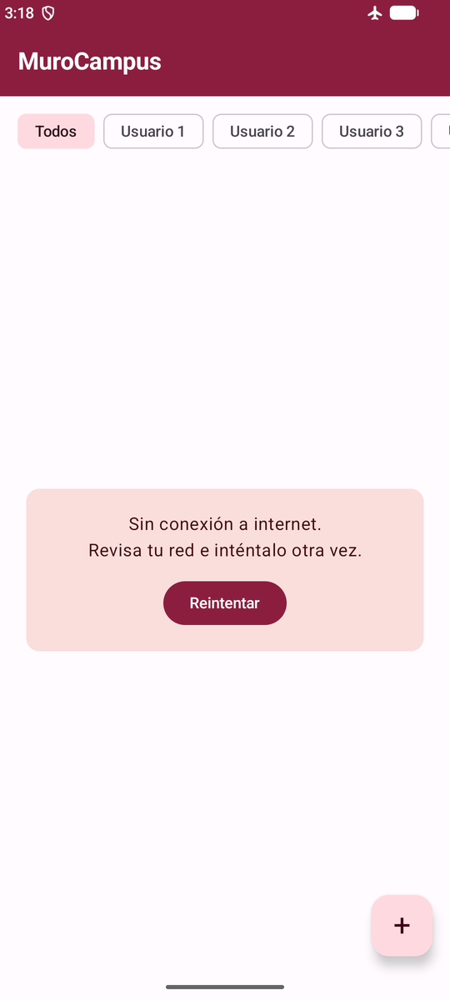

# MuroCampus

Laboratorio 09 · Servicios web con Retrofit  
Johan Salazar Atencio · Programación en Móviles · TECSUP · Docente: Juan León S.

## Descripción

App Android con Kotlin, Jetpack Compose y Material 3 que consume el servicio web REST JSONPlaceholder con Retrofit, OkHttp y kotlinx.serialization. Usa arquitectura MVVM con Repository.

Qué hace:

- Lista las 100 publicaciones, cada una con su etiqueta de usuario, título y resumen.
- Filtra por usuario con una fila de chips (Todos, Usuario 1 a Usuario 10).
- Muestra el detalle de una publicación con sus 5 comentarios.
- Crea una publicación nueva con POST; el servicio responde con el id 101 pero no la guarda.
- Muestra tres estados (Cargando, Éxito y Error con botón Reintentar), también sin internet.

Declara el permiso INTERNET. Color principal guinda (`#8B1E3F`), con esquema claro y oscuro.

## Estructura de paquetes

```
com.salazar.murocampus/
 ├─ MainActivity.kt
 ├─ model/       Modelos.kt          (Post, Comentario, NuevoPost, Usuario)
 ├─ data/        PostRepository.kt   (interface + PostRepositoryRemote)
 │               Errores.kt          (mensajeDe)
 │  └─ remote/   PostApi.kt, RetrofitClient.kt
 ├─ viewmodel/   PostsViewModel.kt, PostsViewModelFactory.kt, UiState.kt
 └─ ui/          Componentes.kt, PantallaLista.kt,
                 PantallaDetalle.kt, PantallaCrear.kt
                 theme/ (Color.kt, Theme.kt)
```

## Arquitectura MVVM + Repository

```
View (PantallaLista, PantallaDetalle, PantallaCrear)
   │ eventos: cargar, filtrar, publicar     ▲ collectAsStateWithLifecycle()
   ▼                                        │
ViewModel (PostsViewModel) ── StateFlow<UiState> (Cargando / Exito / Error) ──►
   │ viewModelScope.launch
   ▼
PostRepository (interface) ◄─ devuelve Result<...>
   └─► PostRepositoryRemote (captura IOException, HttpException...)
          │
          ▼
       PostApi (Retrofit) ── OkHttp ──► https://jsonplaceholder.typicode.com/
```

- La pantalla solo conoce al ViewModel; el ViewModel solo conoce la interface `PostRepository`.
- El Repository convierte cualquier excepción de red en `Result.failure`; nunca la deja escapar.
- En `viewmodel/` no aparecen Retrofit, `PostApi`, `HttpException` ni `Context`.

## Capturas

| Lista de publicaciones | Detalle con comentarios | Filtro: Usuario 2 |
|:---:|:---:|:---:|
|  |  |  |

| Crear publicación | Error de conexión |
|:---:|:---:|
|  |  |

## Para pensar

**1. ¿Qué diferencia hay entre GET y POST? ¿Por qué crear lleva `@Body` y `porUsuario` lleva `@Query`?**  
GET lee un recurso y no cambia nada en el servidor. POST envía datos para crear uno nuevo. Crear lleva `@Body` porque la publicación nueva (`NuevoPost`) viaja como JSON en el cuerpo de la petición. `porUsuario` lleva `@Query` porque el usuario es solo un filtro que se agrega a la URL (`posts?userId=2`): no crea nada ni identifica un recurso.

**2. ¿Por qué la ruta es `"posts"` y no `"/posts"`?**  
Con la barra al inicio, Retrofit la toma como ruta absoluta y reemplaza el camino de la URL base. Sin barra, la une a la base. Aquí da igual porque la base no tiene camino, pero si mañana fuera `.../api/v1/`, `"/posts"` borraría ese camino.

**3. ¿Por qué el Repository devuelve `Result` en vez de dejar que la excepción llegue al ViewModel?**  
Así el ViewModel no necesita `try/catch` ni conocer `IOException` ni `HttpException`: recibe éxito o fallo como un valor y solo decide qué estado mostrar. Si cambia la fuente de datos, el ViewModel y la pantalla no cambian. Además obliga a tratar el caso de error y no se olvida. La `CancellationException` sí se relanza, porque tragársela rompería la cancelación de las corrutinas.

**4. ¿Qué pasa si olvidas el permiso INTERNET? ¿Y si olvidas `ignoreUnknownKeys` y el servidor agrega un campo nuevo?**  
Sin el permiso la app compila, pero la llamada falla y se ve el error de red aunque haya internet. Sin `ignoreUnknownKeys`, un campo nuevo que el modelo no conoce lanza `SerializationException` y toda la respuesta falla (la app muestra "Respuesta inesperada"). Con él, el campo extra se ignora y todo sigue funcionando.

**5. ¿Por qué la pantalla de lista usa un `when` sobre `UiState` y no un `if` con tres variables?**  
Los tres estados son excluyentes. Con tres variables sueltas podrían quedar combinaciones imposibles (cargando y error a la vez). Un `when` sobre una `sealed interface` guarda un solo estado y el compilador exige cubrir todos los casos.

**6. JSONPlaceholder no guarda los POST. ¿Cómo cambiaría tu app si usaras un servicio real?**  
La publicación nueva sí aparecería al recargar la lista, y el id sería el real. El `userId` dejaría de ser 1 fijo: saldría del usuario que inició sesión. Habría que enviar un token en un Interceptor, tratar errores como 401 o 422 y refrescar la lista después de publicar. Para ver lo publicado sin internet convendría guardar una copia local (por ejemplo con Room).
