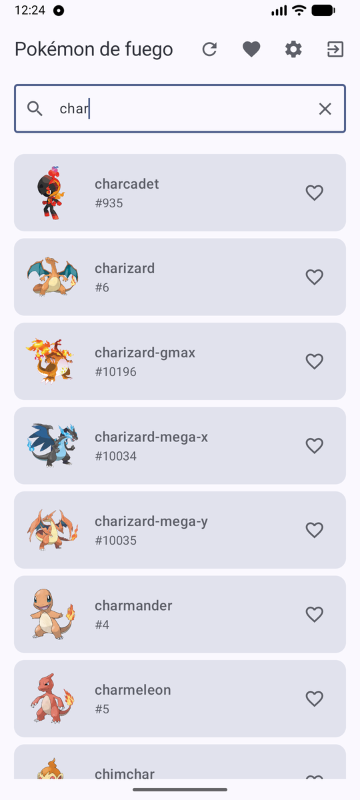
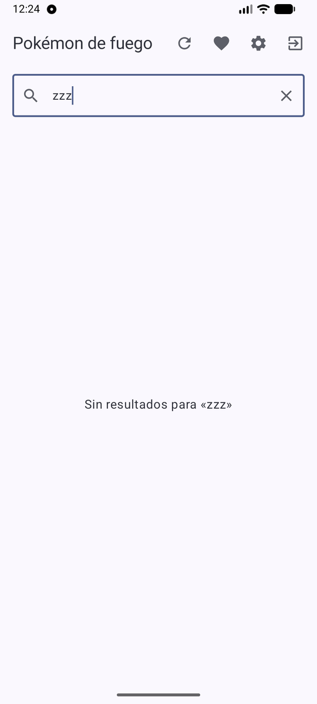
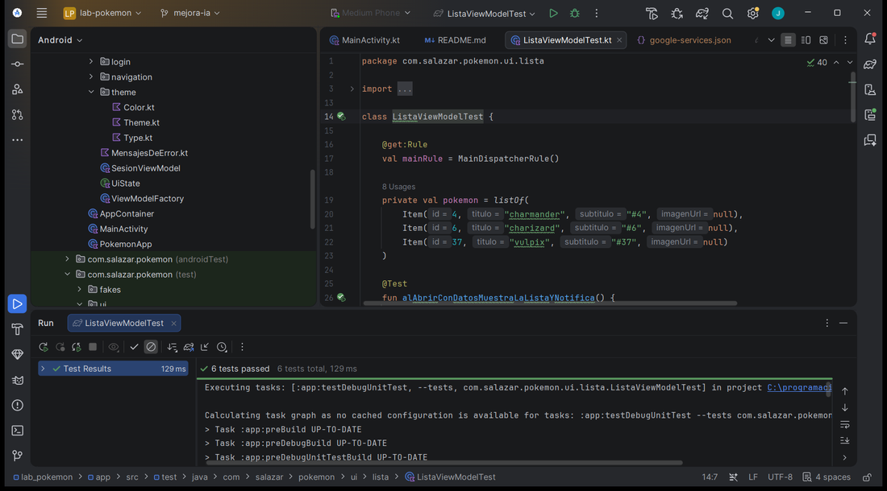
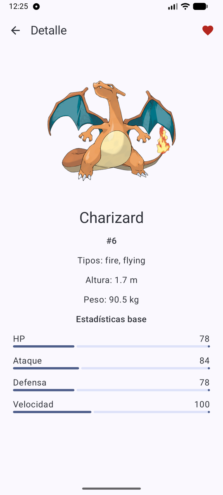
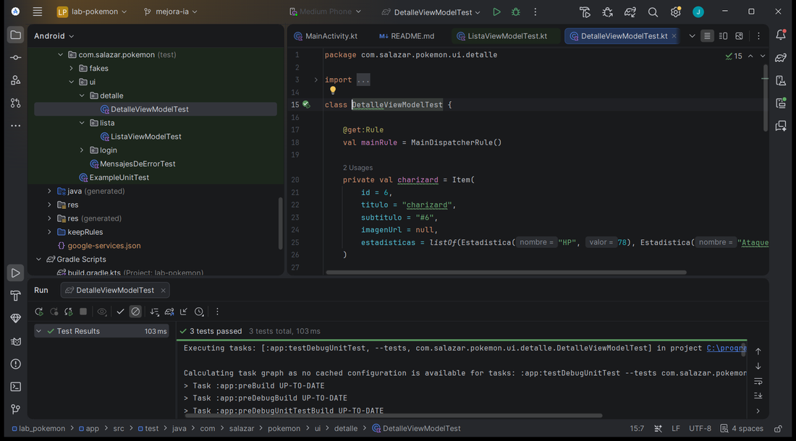
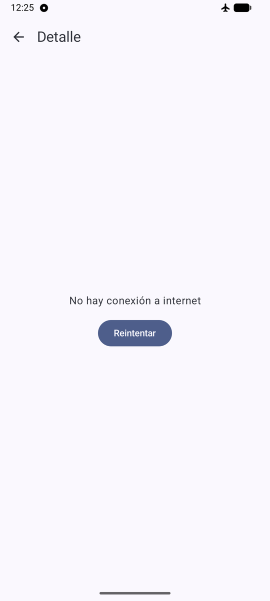
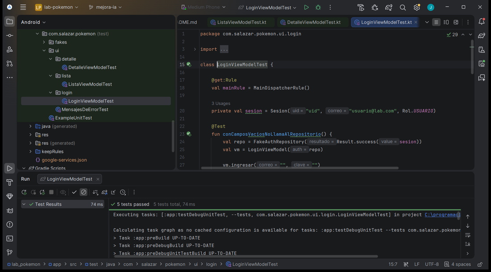
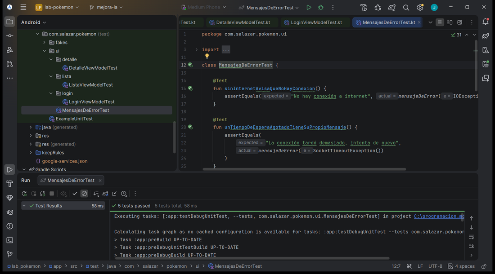

# PROMPTS: Fase 2 (mejora con IA)

## Consulta 1
- Fecha: 8 de noviembre de 2026
- Herramienta: Claude Code
- Prompt: En la pantalla de lista de mi app Pokédex (Compose + MVVM + Room), agrega un campo de búsqueda para filtrar los Pokémon por nombre. El filtro debe hacerse en el ListaViewModel sobre la lista que sale de Room, sin volver a llamar a la API, y la pantalla solo debe observar el estado. Agrega mínimo 3 pruebas unitarias del ListaViewModel con un repositorio y un notificador falsos. Comentarios solo si son necesarios.
- Qué respondió (resumen): Agregó `consulta` y `buscar()` al ListaViewModel, que combina `repo.items` con el texto y filtra por nombre sin distinguir mayúsculas; un campo de búsqueda en ListaScreen con un mensaje cuando no hay resultados; y 6 pruebas con `FakeItemRepository` y `FakeNotificador`. Commit: `feat: busqueda de Pokemon por nombre`.
- Qué usamos / qué cambiamos y por qué: Nada.
- Qué aprendimos: Filtrar en el ViewModel y no en la pantalla mantiene la lógica probable y evita llamadas extra a la red.

## Consulta 2
- Fecha: 8 de noviembre de 2026
- Herramienta: Claude Code
- Prompt: En la pantalla de detalle agrega el botón de favorito (corazón) usando la misma función alternarFavorito del repositorio, y muestra las estadísticas base del Pokémon (HP, ataque, defensa y velocidad) que ya devuelve el endpoint pokemon/{id}. Mantén MVVM: DetalleDto con stats, el mapper y el DetalleViewModel, sin lógica en el composable.
- Qué respondió (resumen): Agregó `stats` al DetalleDto, el modelo `Estadistica` y su mapper, `alternarFavorito()` en el DetalleViewModel, el corazón en la barra de DetalleScreen y las cuatro estadísticas con una barra de progreso. Incluye 3 pruebas del DetalleViewModel. Commit: `feat: favorito desde el detalle y estadisticas`.
- Qué usamos / qué cambiamos y por qué: Nada.
- Qué aprendimos: Las estadísticas vienen en el mismo endpoint del detalle, así que no hace falta otra llamada; reutilizar el método del repositorio deja un solo lugar donde se guarda el favorito.

## Consulta 3
- Fecha: 8 de noviembre de 2026
- Herramienta: Claude Code
- Prompt: Mejora el manejo de errores de la app: agrega tiempos de espera a OkHttp, haz que los ViewModel distingan error de red, error del servidor y respuesta inesperada con mensajes claros, y en el login distingue «sin conexión» de «correo o contraseña incorrectos». Agrega pruebas de estos casos.
- Qué respondió (resumen): Configuró los tiempos de espera del cliente (10 s de conexión y 15 s de lectura y escritura), unificó los mensajes en `mensajeDeError()` (red, tiempo agotado, servidor y respuesta no válida), hizo que el repositorio capture los errores de serialización y que el login distinga credenciales incorrectas, demasiados intentos y falta de conexión. Agregó 10 pruebas. Commit: `fix: mejorar el manejo de errores`.
- Qué usamos / qué cambiamos y por qué: Nada.
- Qué aprendimos: Un tiempo de espera evita que la pantalla quede cargando para siempre, y separar los tipos de error permite avisar mejor a la persona.

## Reflexión
La IA ayudó a escribir más rápido el código repetitivo y las pruebas, pero hubo que revisar que cumpliera las reglas de MVVM (ni Retrofit ni Room en los composables, ViewModel sin Context) y que compilara. Un prompt que indica la capa y la restricción dio mejores resultados que uno general.
