# Laboratorio 11-12: MVVM, Room, Retrofit y Firebase

**Curso:** Programación en Móviles  
**Docente:** Juan José León Suiyon  
**Estudiante:** Johan Salazar Atencio  
**Ciclo:** 4.º ciclo, Diseño y Desarrollo de Software, Tecsup  
**Tema:** Pokémon (PokeAPI), variante tipo `fire`  


---

## Descripción del proyecto

Aplicación Android en **Kotlin con Jetpack Compose** que consulta los Pokémon de tipo fuego de PokeAPI. Tiene inicio de sesión con dos roles (administrador y usuario), lista y detalle, favoritos que se guardan en el teléfono, modo sin conexión, un panel de administración y una notificación local al sincronizar.

Se aplica el patrón **MVVM** con **Retrofit** (dos endpoints), **Room** como fuente única de datos y **Firebase Authentication y Firestore** para el ingreso y el rol.

**Endpoints:** `GET type/fire` (lista de 109 Pokémon) y `GET pokemon/{id}` (detalle).

## Tecnologías

- **Kotlin 2.2.10**, Android Gradle Plugin 9.3.3, minSdk 24.
- **Jetpack Compose** (BoM 2026.02.01) con Material 3 y Navigation Compose 2.8.4. Sin XML en la interfaz.
- **Retrofit 2.11.0** con kotlinx-serialization 1.7.3 y OkHttp 4.12.0.
- **Room 2.8.5** con KSP 2.3.13.
- **Firebase** (BoM 34.12.0): Authentication y Firestore. Plugin google-services 4.5.0.
- **Coil 3.0.4** para las imágenes.

## Arquitectura MVVM

Paquete base `com.salazar.pokemon`. Cada capa tiene una responsabilidad:

```
com.salazar.pokemon/
  MainActivity.kt   PokemonApp.kt   AppContainer.kt
  data/
    remote/       ApiService, RetrofitClient, dto/ItemDto, dto/DetalleDto
    local/        ItemEntity, ItemDao, AppDatabase
    auth/         AuthRepository (interface), FirebaseAuthRepository
    repository/   ItemRepository (interface), ItemRepositoryImpl
    mapper/       Mappers.kt  (Dto -> Entity -> Item)
  domain/model/   Item, Sesion, Rol
  notification/   Notificador (interface), NotificadorAndroid
  ui/
    navigation/AppNav   UiState   SesionViewModel   ViewModelFactory
    login/  lista/  detalle/  favoritos/  admin/  components/  theme/
```

- **Pantallas (ui):** solo observan el estado con `collectAsStateWithLifecycle()` y llaman funciones del ViewModel.
- **ViewModel:** expone un `StateFlow<UiState<T>>` (Cargando, Exito, Error). No recibe `Context`; la notificación se pide por la interface `Notificador`.
- **Repository:** es una interface; el ViewModel nunca depende de la clase concreta.
- **Tres modelos:** `ItemDto` (lo que responde la API), `ItemEntity` (tabla de Room) e `Item` (lo que usa la UI), convertidos por los mappers.
- **Room es la única fuente de datos:** la lista siempre sale de la base; Retrofit solo la actualiza.
- **Factory:** los ViewModel se crean con un `ViewModelProvider.Factory` que recibe el `AppContainer`.

## Evidencias

### Firebase

Authentication con los dos usuarios de prueba, los documentos de Firestore con el rol y las reglas publicadas.

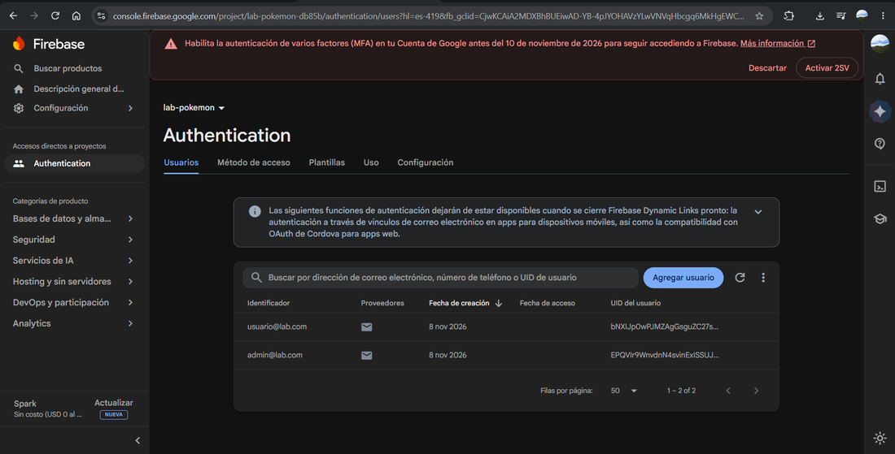

*Figura 1. Authentication: usuarios de prueba (admin y usuario).*

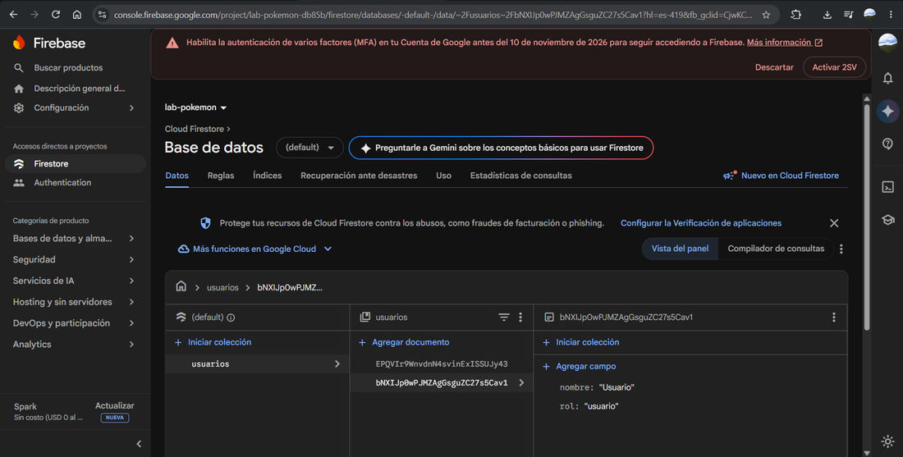

*Figura 2. Firestore: colección usuarios, documento con rol y nombre.*

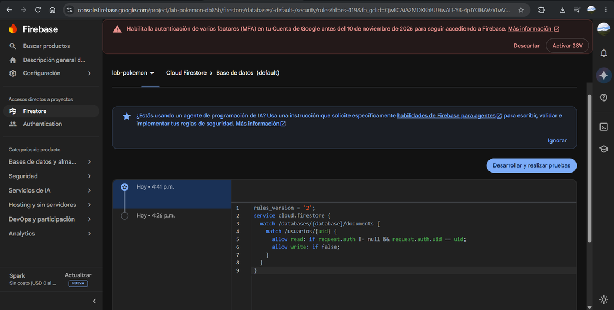

*Figura 3. Reglas de seguridad de Firestore publicadas.*

### Ingreso y sesión

| 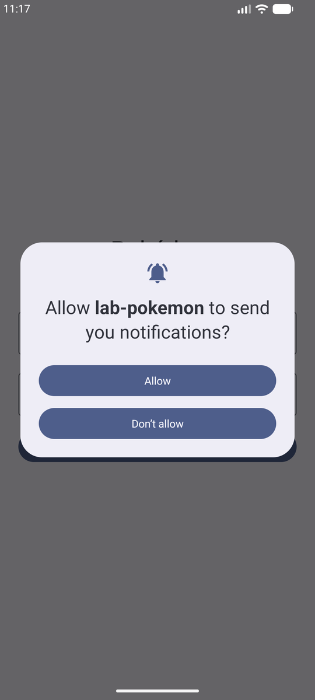 |  | 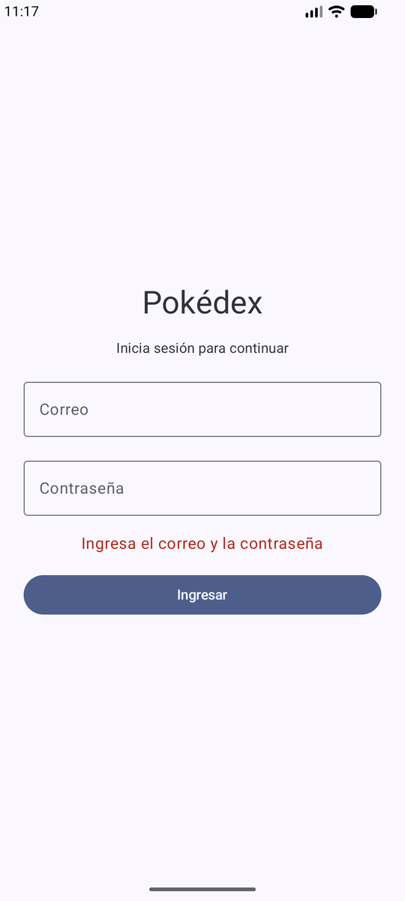 |
|:-:|:-:|:-:|
| *Figura 4. Primera apertura: permiso de notificaciones.* | *Figura 5. Pantalla de login.* | *Figura 6. Campos vacíos: validación sin llamar a Firebase.* |

| 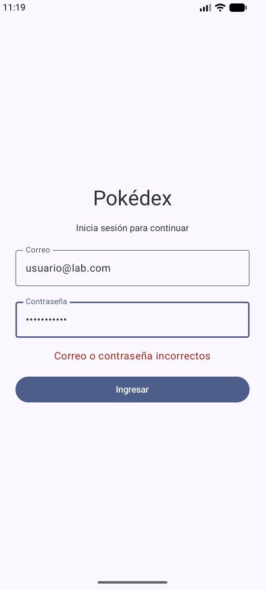 | 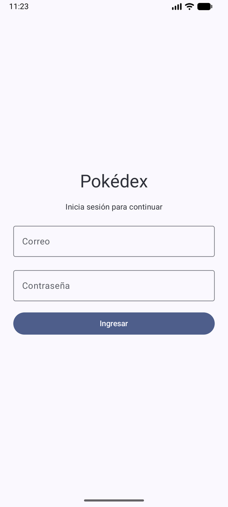 |   |
|:-:|:-:|:-:|
| *Figura 7. Contraseña incorrecta: mensaje de error.* | *Figura 8. Tras cerrar sesión y reabrir, pide credenciales.* |   |

### Lista, detalle y favoritos

| 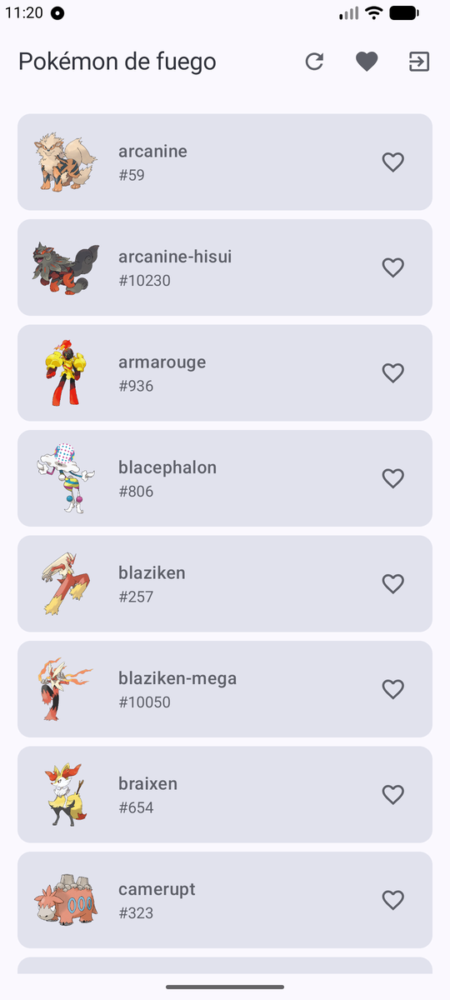 | 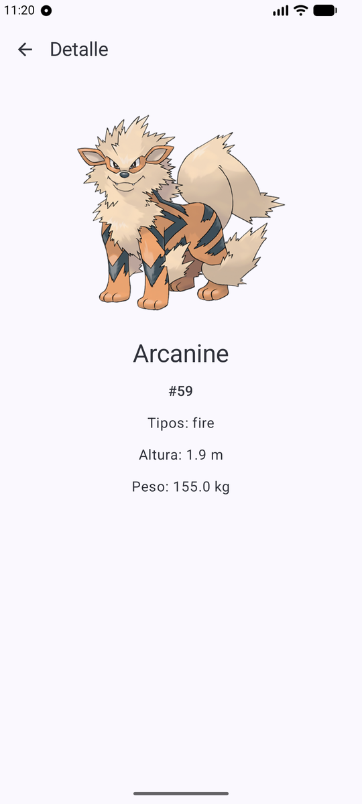 | 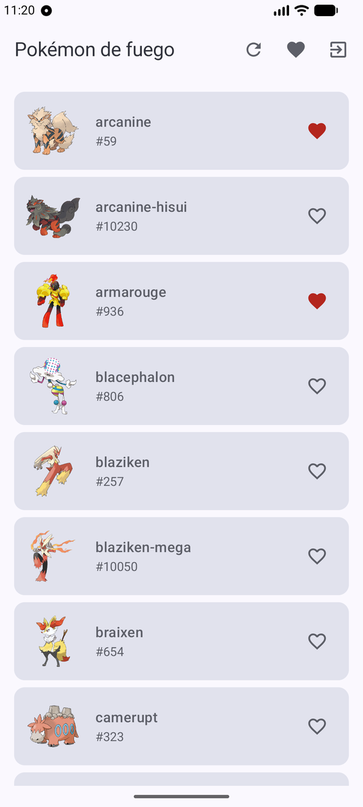 |
|:-:|:-:|:-:|
| *Figura 9. Lista del usuario (sin acceso al panel Admin).* | *Figura 10. Detalle con el segundo endpoint.* | *Figura 11. Favoritos marcados en la lista.* |

| 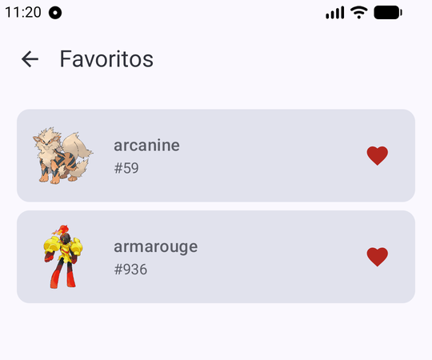 |  | 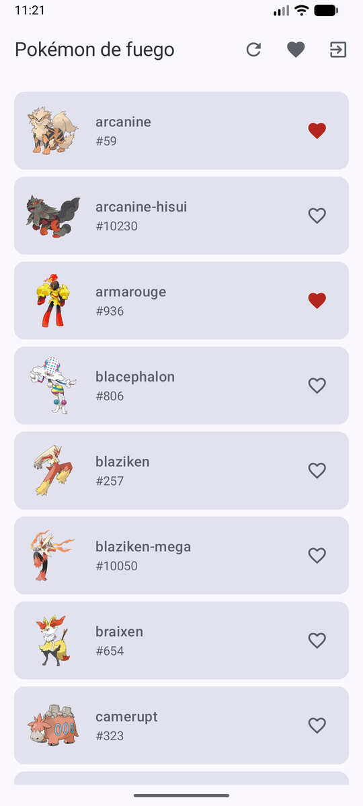 |
|:-:|:-:|:-:|
| *Figura 12. Pantalla Favoritos.* | *Figura 13. Al sincronizar, los favoritos se conservan.* | *Figura 14. Al cerrar y reabrir la app siguen marcados.* |

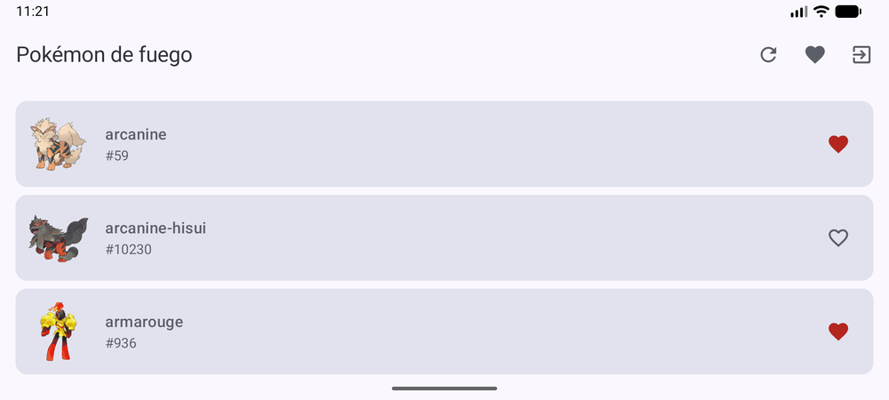

*Figura 15. Al girar la pantalla se mantiene la lista.*

### Notificación local

| 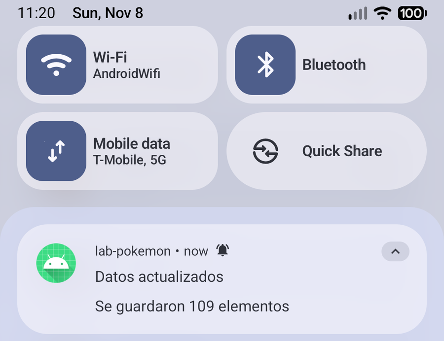 |   |
|:-:|:-:|
| *Figura 16. Notificación «Se guardaron 109 elementos».* |   |

|  | 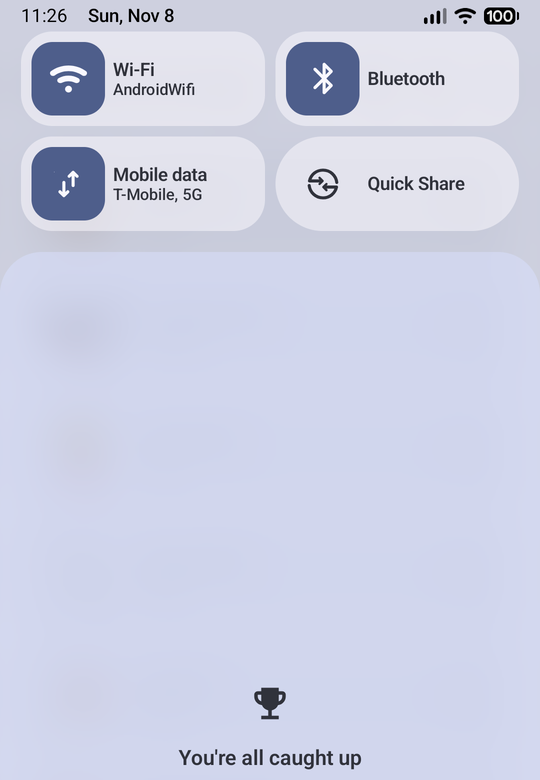 |   |
|:-:|:-:|:-:|
| *Figura 17. Permiso negado: la app sigue funcionando.* | *Figura 18. Permiso negado: no aparece ninguna notificación.* |   |

### Modo sin conexión

| 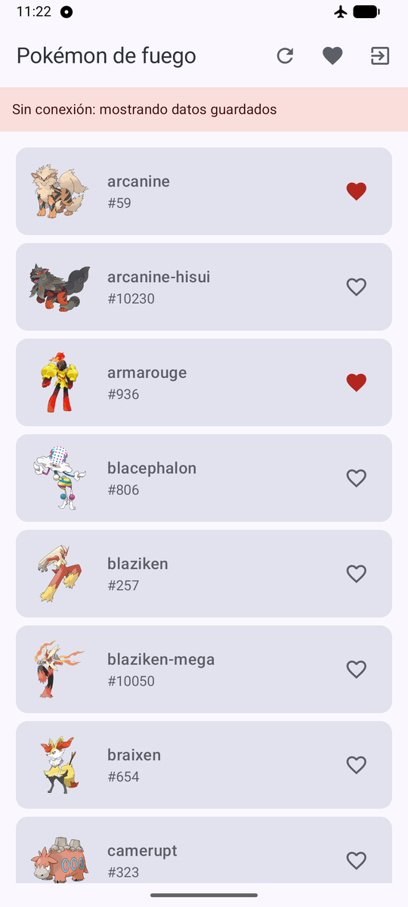 | 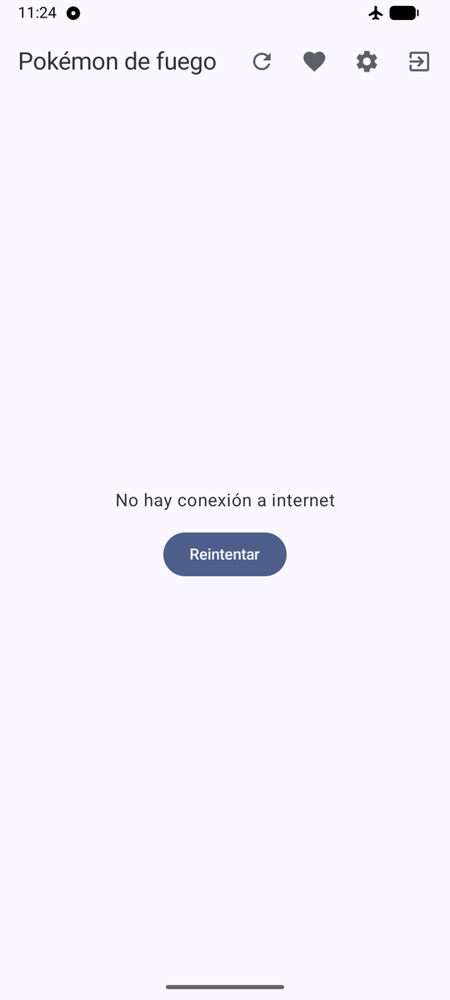 | 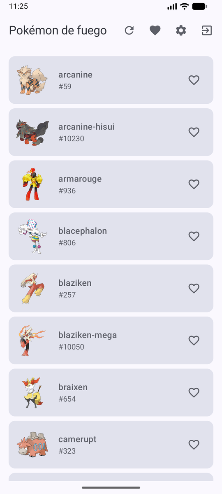 |
|:-:|:-:|:-:|
| *Figura 19. Sin internet y con datos: aviso y lista guardada.* | *Figura 20. Sin internet y sin datos: error con Reintentar.* | *Figura 21. Con internet de nuevo, los datos vuelven.* |

### Rol administrador

| 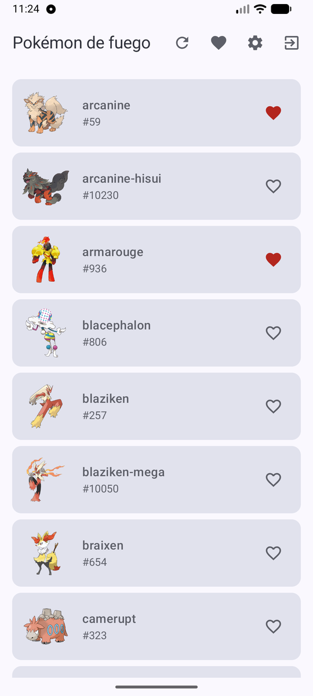 | 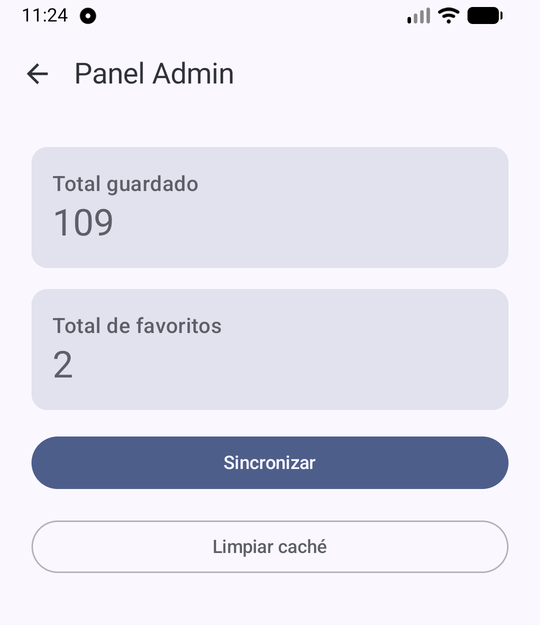 | 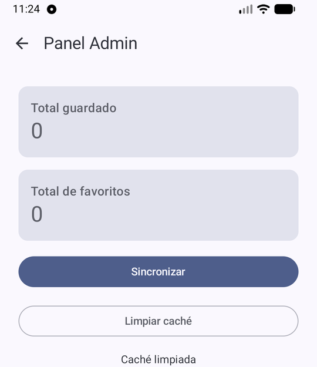 |
|:-:|:-:|:-:|
| *Figura 22. El administrador ve el acceso al panel.* | *Figura 23. Panel Admin: totales, Sincronizar y Limpiar caché.* | *Figura 24. Tras limpiar la caché los totales quedan en 0.* |

| 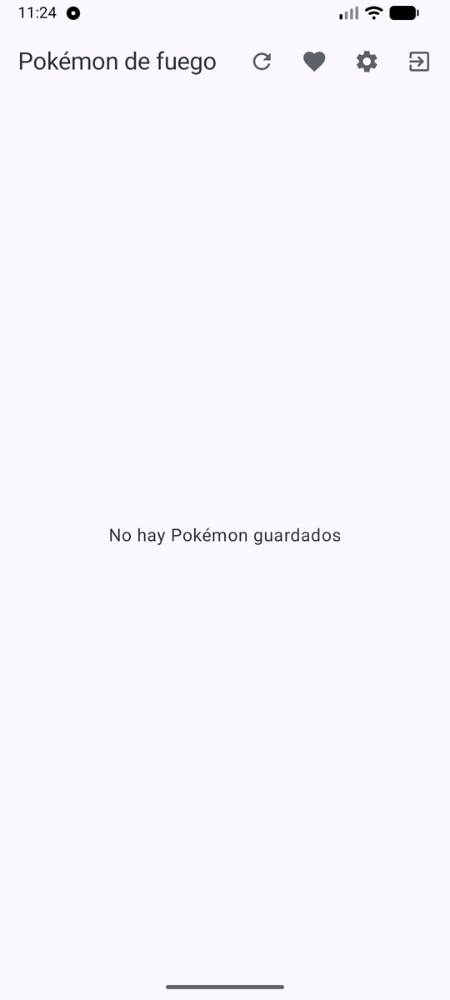 |   |   |
|:-:|:-:|:-:|
| *Figura 25. La lista queda vacía tras limpiar la caché.* |   |   |

## Preguntas y respuestas de la sustentación

**1. ¿Por qué el repository es una interface? ¿Qué cambiaría si no lo fuera?**
El ViewModel depende del contrato `ItemRepository` y no de Retrofit ni de Room. Así se puede cambiar la fuente de datos o usar un repositorio falso en las pruebas sin tocar la interfaz. Si fuera una clase concreta, el ViewModel quedaría atado a la red y a la base, y no se podría probar sin ellas.

**2. ¿Por qué la lista sale de Room y no directamente de Retrofit?**
Room es la única fuente de datos: la pantalla siempre lee de la base y Retrofit solo la actualiza. Por eso funciona sin internet y no hay dos fuentes que se contradigan.

**3. ¿Qué pasa con los favoritos cuando sincronizas?**
En `ItemRepositoryImpl.refrescar()` se leen los ids favoritos con `dao.idsFavoritos()` antes de guardar. Como `@Upsert` sobrescribe la fila, a cada elemento nuevo se le vuelve a poner `esFavorito = true` si su id estaba en ese conjunto.

**4. ¿Dónde se decide el rol de la persona y por qué no en la pantalla?**
`FirebaseAuthRepository.leerSesion()` lee el campo `rol` de `usuarios/{uid}` en Firestore y devuelve una `Sesion`. La pantalla solo recibe ese dato y decide qué mostrar. El rol no se escribe en el código; lo que protege los datos de verdad son las reglas de Firestore.

**5. ¿Qué ocurre si el permiso de notificaciones está negado?**
`NotificadorAndroid.mostrar()` comprueba el permiso `POST_NOTIFICATIONS` y, si no está concedido, no muestra nada. La sincronización y la app siguen funcionando igual.

**6. ¿Por qué el ViewModel no recibe Context?**
Para que no dependa de la vista y se pueda probar. La notificación se pide mediante la interface `Notificador`, cuya implementación con `Context` vive en otra capa.

**7. ¿Para qué sirven ItemDto, ItemEntity e Item?**
Son tres modelos distintos: lo que responde la API, la tabla de Room y lo que usa la interfaz. Los mappers los convierten, y un cambio en la API no obliga a cambiar las pantallas.

**8. ¿Cómo se mantiene la sesión al reabrir la app?**
Firebase Auth conserva el usuario. Al abrir, `SesionViewModel` llama a `sesionActual()` y `AppNav` elige entre la lista (hay sesión) y el login (no la hay).

**9. Muestra un commit tuyo y explica qué cambió.**
Por ejemplo «refactor: Room como fuente de verdad»: el repositorio pasó a recibir el `ItemDao`, `items` y `favoritos` salen de Room y se agregaron los mappers Dto a Entity y Entity a Item.
