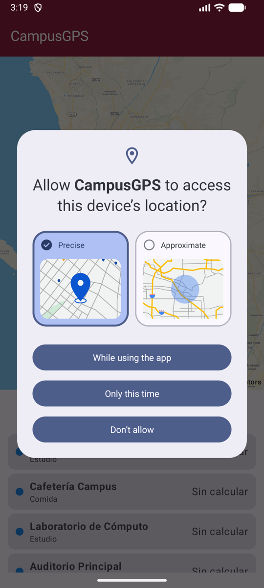
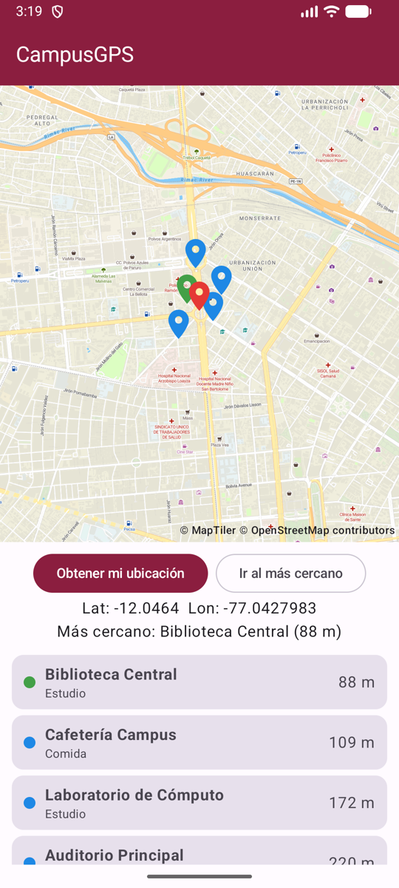
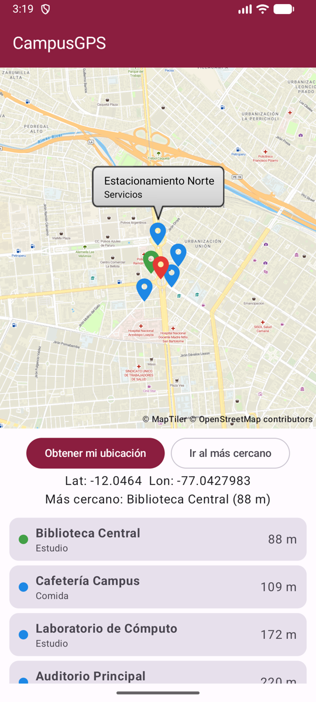
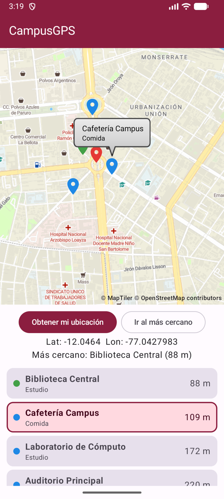
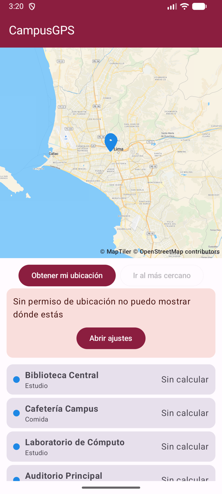

# CampusGPS

Laboratorio 13 · Programación en Móviles · Johan Salazar Atencio · Tecsup

## Descripción

App Android en Kotlin con Jetpack Compose, Material 3 y arquitectura MVVM + Repository. Obtiene la ubicación del celular con FusedLocationProviderClient, la muestra en un mapa y ordena cinco lugares ficticios del campus (biblioteca, cafetería, laboratorio, auditorio y estacionamiento) del más cercano al más lejano. Maneja permiso denegado, GPS apagado y falta de Google Play Services.

**Mapa:** se usa MapTiler (teselas con osmdroid) en lugar de Google Maps Compose, porque Google exige tarjeta para activar Maps SDK for Android. La clave se guarda en `local.properties` como `MAPTILER_KEY` y llega a la app con `manifestPlaceholders`; no está en el repositorio. Para ejecutar el proyecto, crear ese archivo con `MAPTILER_KEY=<tu clave>`.

## Estructura de paquetes

```
com.tecsup.campusgps/
├── MainActivity.kt
├── model/
│   └── Modelos.kt
├── data/
│   ├── UbicacionRepository.kt
│   ├── UbicacionRepositoryGoogle.kt
│   ├── LugaresRepository.kt
│   └── LugaresRepositoryLocal.kt
├── util/
│   ├── Distancia.kt
│   └── Formato.kt
├── viewmodel/
│   ├── MapaViewModel.kt
│   └── CampusViewModelFactory.kt
└── ui/
    ├── PantallaMapa.kt
    ├── MapaUbicacion.kt
    ├── ListaLugares.kt
    ├── MensajeError.kt
    └── theme/ (Color.kt, Theme.kt)
```

## Arquitectura MVVM

La View observa el estado del ViewModel y le envía eventos; el ViewModel usa solo las interfaces de los repositorios.

```
View (PantallaMapa)
   |  evento (botón)          ^  StateFlow / collectAsState
   v                         |
ViewModel (MapaViewModel)
   |  usa las interfaces
   v
UbicacionRepository  ->  UbicacionRepositoryGoogle (Fused)
LugaresRepository    ->  LugaresRepositoryLocal (5 lugares)
```

## Capturas

| Permiso de ubicación | Mapa con tu ubicación | Marcadores de los lugares |
|---|---|---|
|  |  |  |

| Lista ordenada y selección | Error con acción |
|---|---|
|  |  |

## Para pensar

**1. ¿Por qué FusedLocationProviderClient está dentro del Repository y no en el ViewModel?**
Porque el ViewModel no debe conocer Play Services ni recibir un Context. Así se puede cambiar o simular la fuente de ubicación sin tocar la lógica, y el ViewModel se puede probar con un repositorio falso.

**2. ¿Qué diferencia hay entre el permiso de ubicación y la clave de API del mapa? ¿Qué pasa si falta cada uno?**
El permiso lo concede el usuario para que la app lea su posición; si falta, no hay ubicación y se muestra el error con Abrir ajustes. La clave identifica a la app ante el servicio de mapas (aquí MapTiler); si falta, el mapa no carga las teselas y queda gris, pero la ubicación sigue funcionando.

**3. ¿Por qué la clave va en local.properties y no en el código? ¿Qué harías si se subiera a GitHub por error?**
Porque `local.properties` está en `.gitignore` y no se sube al repositorio. Si se subiera, la revocaría en MapTiler, crearía otra, la pondría en `local.properties` y revisaría el historial y el `.gitignore`.

**4. ¿Dónde calculas la distancia y por qué no en el Composable?**
En `util/Distancia.kt`, llamada desde `actualizarDistancias` del ViewModel. Un Composable solo debe dibujar el estado: si calculara, se repetiría en cada recomposición, mezclaría la lógica con la vista y rompería MVVM.

**5. ¿Qué pasa con tu app si el usuario niega el permiso dos veces? ¿Cómo lo manejas?**
Android deja de mostrar el cuadro de permiso. La app no se cierra: muestra el mensaje y el botón Abrir ajustes, que lleva a la pantalla de la app para conceder el permiso manualmente.
