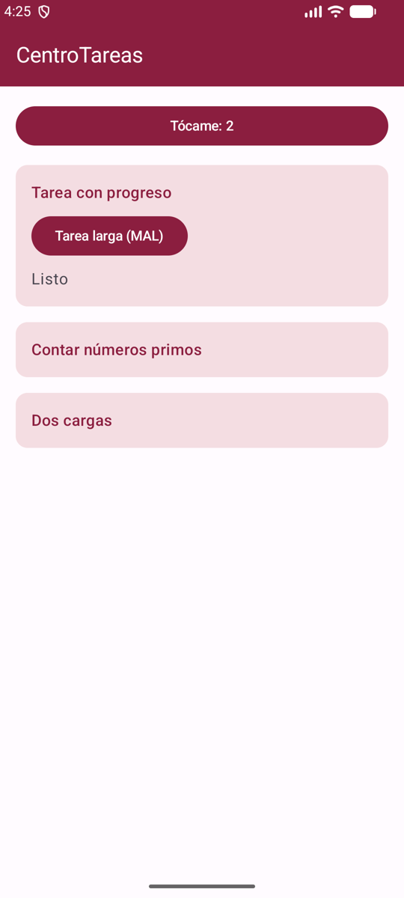
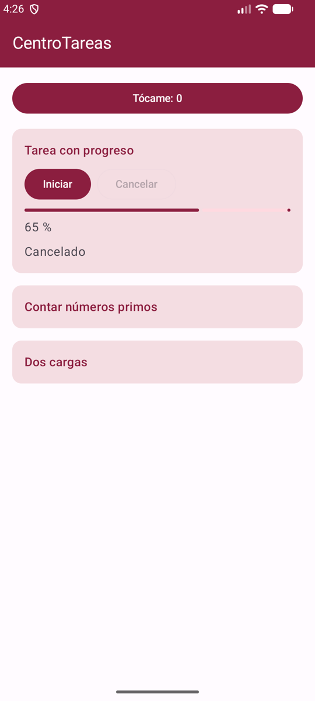
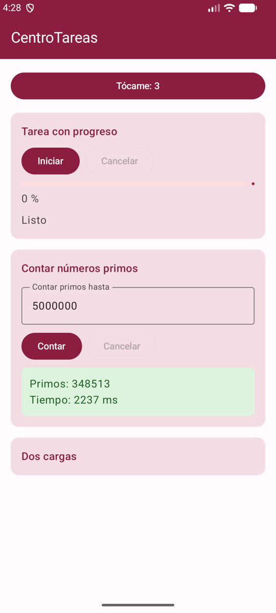
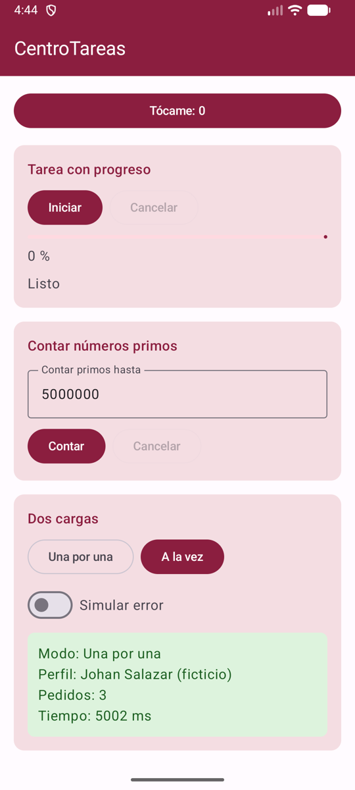
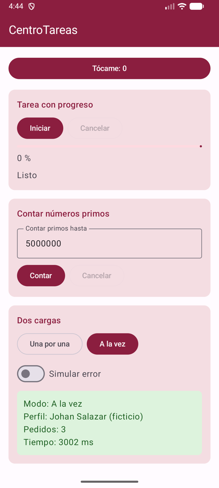
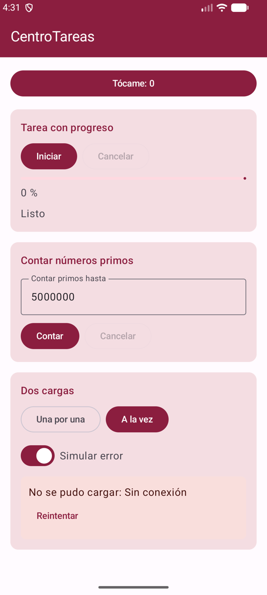

# CentroTareas

Laboratorio 14 · Hilos en Android  
Johan Salazar Atencio · Programación en Móviles · TECSUP · Docente: Juan León S.

## Descripción

App Android con Kotlin, Jetpack Compose y Material 3 (sin XML) que muestra por qué el hilo principal nunca debe bloquearse y cómo lograrlo con corrutinas. Tiene tres tarjetas:

- **Tarea con progreso:** primero se congela la pantalla (Paso 1) y luego se corrige con `viewModelScope` y `withContext`, con barra de progreso y cancelación.
- **Contar números primos:** cálculo pesado en `Dispatchers.Default`, cancelable con `ensureActive()`.
- **Dos cargas:** perfil (2 s) y pedidos (3 s) simulados con `delay`, una por una (5 s) contra a la vez con `async` (3 s), con error simulado y reintento.

Todo con datos ficticios, sin permisos ni conexión. Color principal guinda (`#8B1E3F`), con esquema claro y oscuro.

## Estructura de paquetes

```
com.salazar.centrotareas/
 ├─ MainActivity.kt
 ├─ model/       Estados.kt            (PrimosUi, CargaUi)
 ├─ data/        TareasRepository.kt   (interface)
 │               TareasRepositoryLocal.kt
 ├─ viewmodel/   TareasViewModel.kt
 │               TareasViewModelFactory.kt
 └─ ui/          PantallaTareas.kt, Resultados.kt
                 theme/ (Color.kt, Theme.kt)
```

## Arquitectura MVVM + Repository

```
View (PantallaTareas)
   │ eventos: botones          ▲ collectAsState()
   ▼                           │
ViewModel (TareasViewModel) ── StateFlow ──►
   │ viewModelScope.launch { ... }
   ▼
TareasRepository (interface) ──► TareasRepositoryLocal
                                 (cargas simuladas y contar primos)
```

- La pantalla solo conoce al ViewModel: muestra estados y avisa eventos, sin lanzar corrutinas.
- El ViewModel solo conoce la interface del Repository y no recibe `Context`.
- El Repository no conoce la UI; sus funciones `suspend` no bloquean el hilo desde el que se llaman.

## Observación del Paso 1

Al tocar **Tarea larga (MAL)** y enseguida **Tócame**, durante 4 segundos nada responde: el contador no suma, el botón no se anima y el texto *Trabajando...* nunca llega a verse. Cuando pasan los 4 s aparece *Terminó* y recién ahí se procesan los toques acumulados (en la primera captura, el contador sigue en 2 durante la espera).

**Por qué no se ve *Trabajando...*:** el hilo principal es el que dibuja la pantalla. `Thread.sleep(4000)` lo deja dormido, así que el estado cambia a *Trabajando...* pero Compose no puede redibujar hasta que la función termina. Para entonces el estado ya es *Terminó* y solo se ve ese.

Con una espera de 10 segundos Android mostraría el aviso «La aplicación no responde» (ANR), porque el hilo principal lleva más de 5 s sin atender la entrada.

## Capturas

| Pantalla congelada (Paso 1) | Tarea cancelada (Paso 4) | Primos hasta 5 000 000 (Paso 5) |
|:---:|:---:|:---:|
|  |  |  |

| Una por una: 5002 ms (Paso 6) | A la vez: 3002 ms (Paso 6) | Error con Reintentar (Paso 7) |
|:---:|:---:|:---:|
|  |  |  |

**Ajuste:** con N = 500 000 el cálculo tardó 337 ms en el emulador, menos de lo que pide la guía. El valor por defecto quedó en 5 000 000, que tarda entre 2 y 3 s y permite ver que la pantalla no se congela.

## Para pensar

**1. ¿Por qué no se veía *Trabajando...* en el Paso 1?**  
Porque `Thread.sleep` bloquea el hilo principal, que es el mismo que dibuja. El estado cambió, pero la pantalla no se pudo redibujar hasta que terminó la espera.

**2. ¿Qué diferencia hay entre `Thread.sleep` y `delay`?**  
`Thread.sleep` bloquea el hilo mientras espera. `delay` suspende la corrutina y deja el hilo libre para otras tareas; además revisa la cancelación, así que se puede cancelar a mitad.

**3. ¿Por qué `Dispatchers.Default` para los primos y `Dispatchers.IO` para la red?**  
`Default` tiene tantos hilos como núcleos y sirve para cálculo que usa procesador. `IO` tiene un pool grande pensado para operaciones que se quedan esperando (red, disco): muchos hilos esperando no gastan procesador.

**4. ¿Qué pasaría con la corrutina si el usuario cierra la pantalla? ¿Qué papel cumple `viewModelScope`?**  
`viewModelScope` se cancela solo cuando el ViewModel se destruye (al salir de la pantalla de forma definitiva), así que la corrutina se cancela y no queda trabajo huérfano. Si solo se rota la pantalla, el ViewModel sobrevive y la tarea continúa.

**5. ¿Por qué `async` tarda 3 s y no 5 s? ¿Qué pasa si una de las dos cargas falla?**  
Porque las dos cargas corren al mismo tiempo y el total es el máximo de las dos (3 s), no la suma (5 s). Si una falla, `coroutineScope` cancela a la otra y la excepción sale por `await()`; el `catch` del ViewModel la convierte en el estado `Error` con el botón Reintentar.
