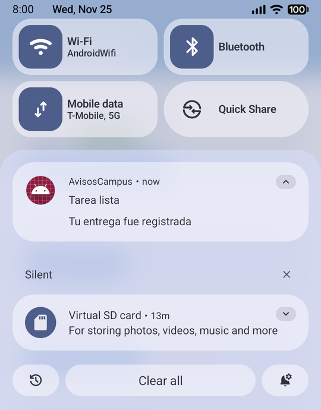
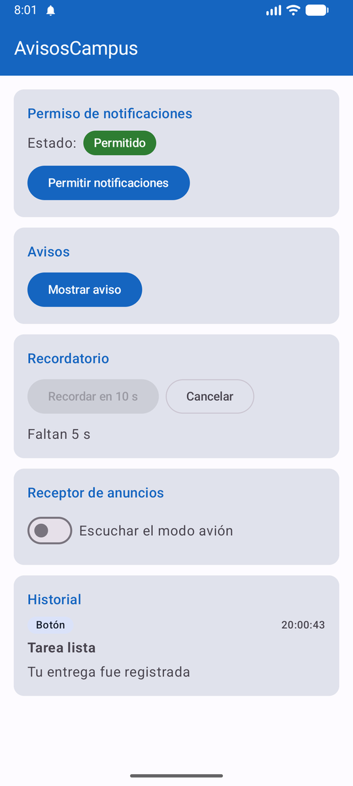
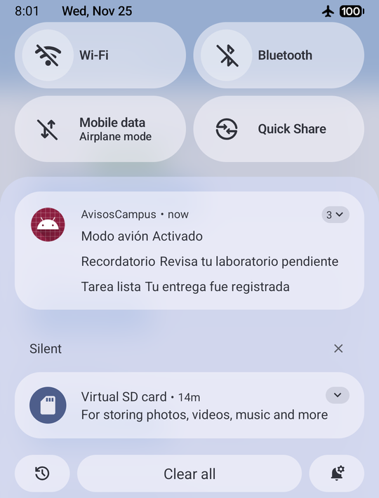
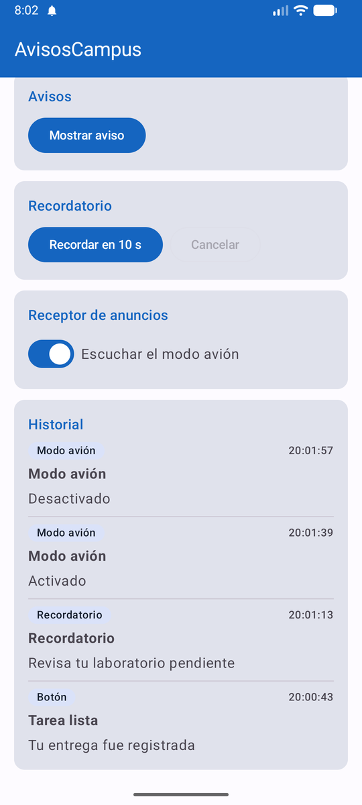
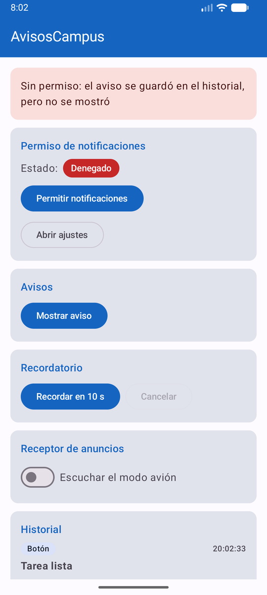

# AvisosCampus

Laboratorio 15 · Notificaciones en Android  
Johan Salazar Atencio · Programación en Móviles · TECSUP · Docente: Juan León S.

## Descripción

App Android con Kotlin, Jetpack Compose y Material 3 (sin XML) que muestra notificaciones locales y escucha lo que pasa en el celular. Tiene cinco tarjetas:

- **Permiso de notificaciones:** pide `POST_NOTIFICATIONS` (Android 13+) y muestra su estado: Sin pedir, Permitido o Denegado.
- **Avisos:** el botón *Mostrar aviso* crea una notificación en el canal Avisos; al tocarla se abre la app.
- **Recordatorio:** aviso que llega a los 10 s, con cuenta regresiva en una corrutina y botón Cancelar.
- **Receptor de anuncios:** con el Switch activo, un `BroadcastReceiver` avisa cuando se activa o desactiva el modo avión.
- **Historial:** los 20 avisos más recientes, el último arriba, con origen y hora.

Si el permiso está denegado la app sigue funcionando: el aviso queda en el historial, se muestra un mensaje de error y hay un botón para abrir los ajustes. Todo con datos ficticios y sin conexión. Color principal azul (`#1565C0`), con esquema claro y oscuro.

## Estructura de paquetes

```
com.salazar.avisoscampus/
 ├─ AvisosApp.kt              (crea el canal al iniciar)
 ├─ MainActivity.kt
 ├─ model/         Modelos.kt              (Aviso, Origen, PermisoUi)
 ├─ data/          AvisosRepository.kt     (interface)
 │                 AvisosRepositoryMemoria (en el mismo archivo)
 ├─ notificacion/  Notificador.kt          (canal, permiso y mostrar)
 ├─ receiver/      ModoAvionReceiver.kt
 ├─ viewmodel/     AvisosViewModel.kt
 │                 AvisosViewModelFactory.kt
 └─ ui/            PantallaAvisos.kt, HistorialAvisos.kt
                   theme/ (Color.kt, Theme.kt)
```

## Arquitectura MVVM + Repository

```
View (PantallaAvisos)
   │ eventos: botones, switch            ▲ collectAsState()
   ▼                                     │
ViewModel (AvisosViewModel) ── StateFlow (avisos, permiso, faltan...) ──►
   │ registra el aviso                   │ emite eventos (SharedFlow<Aviso>)
   ▼                                     ▼
AvisosRepository (interface)         La View recibe el evento y llama a
   └─► AvisosRepositoryMemoria       Notificador.mostrar(context, aviso)
```

- La pantalla solo conoce a su ViewModel y al Notificador; no decide qué se avisa ni guarda el historial.
- El ViewModel solo conoce la interface del Repository y no usa `Context`, `NotificationManager` ni `BroadcastReceiver`.
- El Repository no usa `Context` ni conoce la UI.
- El Notificador es el único que habla con el sistema (canal, permiso y `NotificationManager`).

## Capturas

| Notificación en el panel (Paso 3) | Recordatorio con cuenta regresiva (Paso 5) | Aviso del modo avión (Paso 6) |
|:---:|:---:|:---:|
|  |  |  |

| Historial de avisos (Paso 7) | Permiso denegado, mensaje y Abrir ajustes (Paso 8) |
|:---:|:---:|
|  |  |

## Para pensar

**1. ¿Por qué una notificación necesita un canal y un permiso? ¿Qué pasa si falta cada uno?**  
Desde Android 8 toda notificación pertenece a un canal, y es el usuario quien decide por canal su importancia y su sonido. Sin canal, Android 8+ no muestra la notificación. Desde Android 13 también hace falta el permiso `POST_NOTIFICATIONS`, que el usuario puede negar: sin él la notificación no aparece. En la app, `Notificador.mostrar` devuelve `false` y se muestra el mensaje de error.

**2. ¿Por qué el ViewModel emite un evento y no muestra la notificación él mismo?**  
Porque mostrar una notificación necesita `Context` y `NotificationManager`, y el ViewModel no debe tenerlos. Decide qué avisar, lo anota en el Repository y emite un evento; la pantalla, que sí tiene `Context`, llama al Notificador. Así el ViewModel se puede probar sin Android. Además, un `SharedFlow` es un evento de una sola vez: no se repite al rotar la pantalla, como pasaría con un estado.

**3. ¿Qué pasa si usas el mismo id en dos notificaciones?**  
La segunda reemplaza a la primera y solo se ve una. Por eso se usa el id del aviso, que es distinto en cada uno: al pulsar *Mostrar aviso* dos veces aparecen dos notificaciones.

**4. ¿Por qué `onReceive` debe ser corto y por qué hay que quitar el receptor al salir?**  
`onReceive` corre en el hilo principal y Android espera que termine enseguida: si hace trabajo largo congela la pantalla y puede provocar un ANR. El receptor registrado queda enlazado al `Context`; si no se quita con `unregisterReceiver` en `onDispose`, sigue vivo después de salir, filtra memoria y puede llamar a una pantalla que ya no existe.

**5. ¿En qué casos usarías una notificación local y en cuáles una push de Firebase?**  
La local se usa cuando el aviso nace en el propio celular y no necesita internet: recordatorios, temporizadores o reacciones a eventos del dispositivo, como el modo avión. La push de Firebase se usa cuando el aviso nace en un servidor y debe llegar aunque la app esté cerrada: mensajes nuevos, avisos del docente o promociones. Necesita internet y un token del dispositivo.
